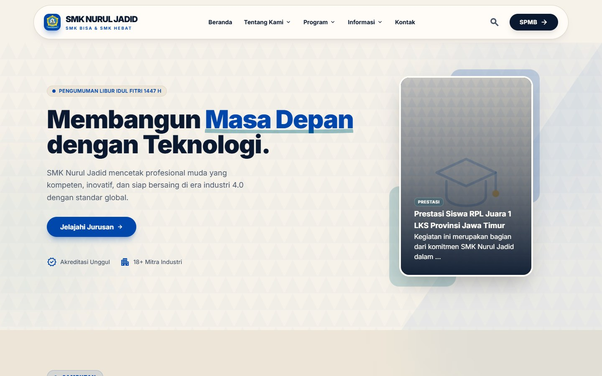
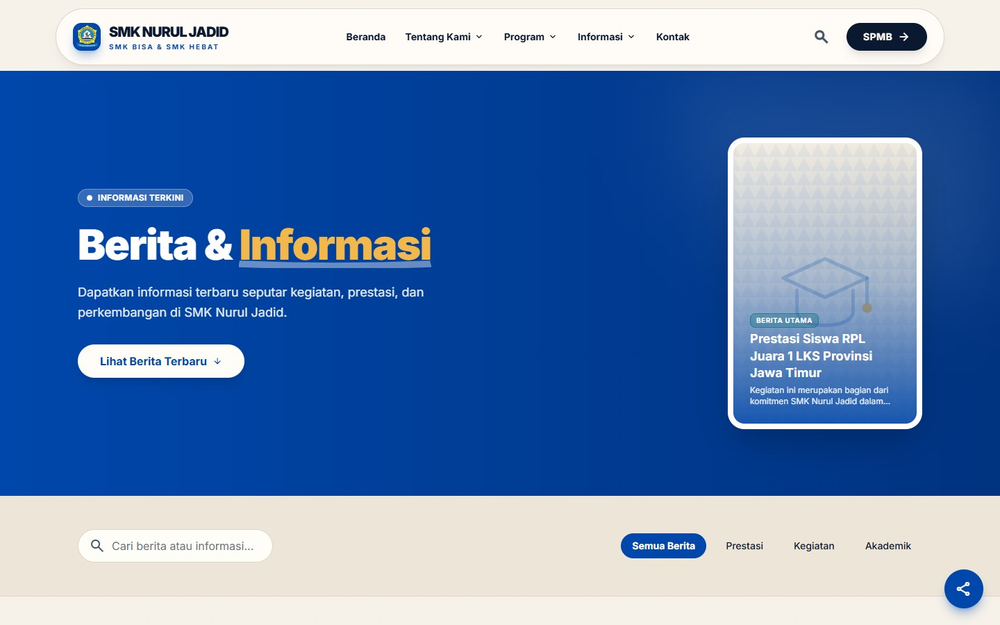
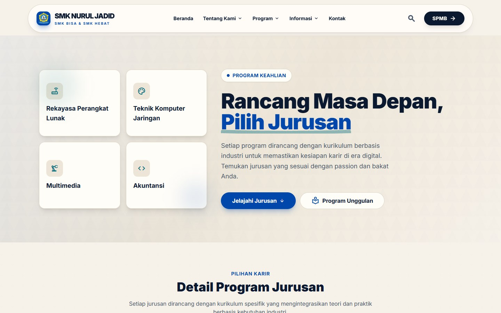
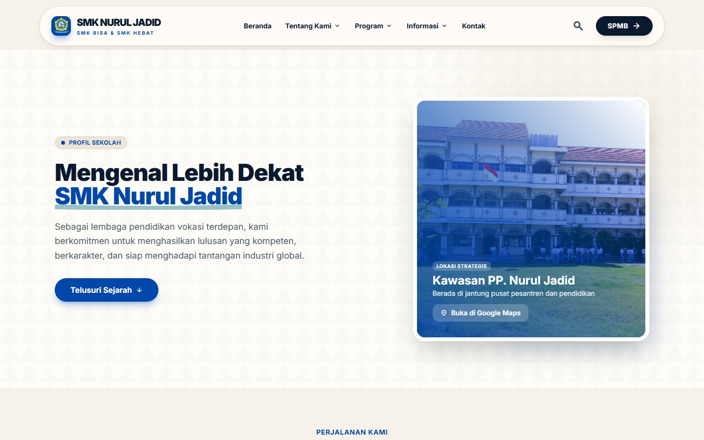
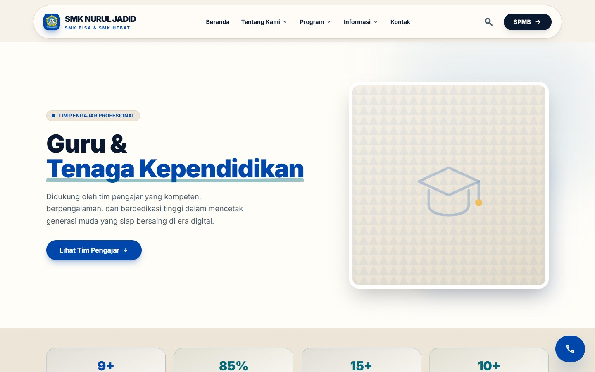
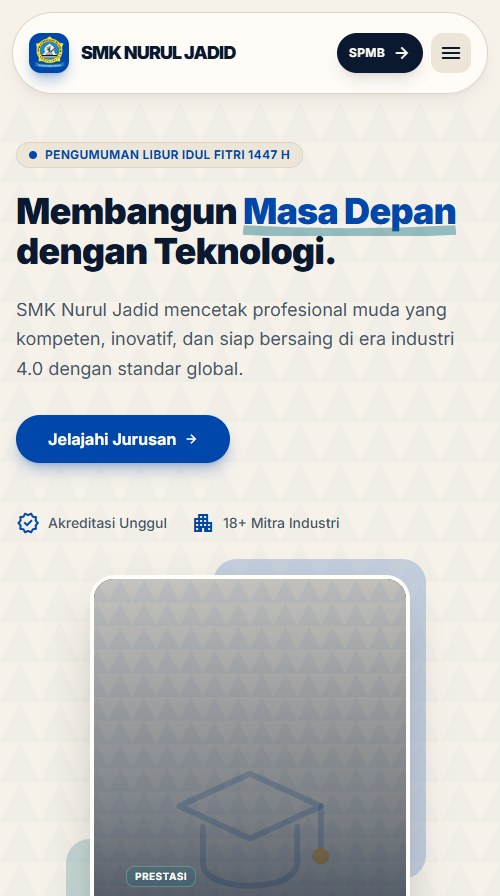

# Portal Web SMK Nurul Jadid

[](https://www.djangoproject.com/)
[](https://www.python.org/)
[](https://www.mysql.com/)
[](https://tailwindcss.com/)
[](https://docs.pylonsproject.org/projects/waitress/)
[](#)
[](#lisensi)

Website resmi SMK Nurul Jadid, Paiton, Probolinggo. Dibangun dengan Django 4.2 dan MySQL untuk
menyajikan profil sekolah, program keahlian, berita, pengumuman, ekstrakurikuler, fasilitas, serta
data guru dan tenaga kependidikan dalam satu portal.

Antarmuka publik memakai Tailwind CSS melalui CDN dengan palet warna hangat dan tata letak grid
yang bervariasi antar halaman. Panel admin memakai Django Jazzmin dengan kustomisasi tema.

---

## Pratinjau

**Beranda** — hero, statistik sekolah, sorotan berita, dan pengumuman.

[](docs/screenshots/home.jpeg)

| Berita & Informasi | Program Keahlian |
| --- | --- |
| [](docs/screenshots/berita.jpeg) | [](docs/screenshots/program-studi.jpeg) |
| **Profil Sekolah** | **Guru & Staf** |
| [](docs/screenshots/profil-sekolah.jpeg) | [](docs/screenshots/guru-staff.jpeg) |

**Tampilan ponsel** — navbar pil, hero, dan kartu berita menyesuaikan lebar layar.



---

## Fitur

**Halaman publik**

- Beranda dengan hero, statistik sekolah, sorotan berita, pengumuman, dan katalog program keahlian.
- Profil sekolah: sejarah, visi, misi, struktur organisasi, dan fasilitas.
- Program keahlian: daftar jurusan dan halaman detail berisi kompetensi hard/soft skill, fasilitas,
  prospek karier, sertifikasi, mitra industri, serta testimoni alumni.
- Berita: kategori, pencarian, halaman detail, dan paginasi sisi server.
- Pengumuman: penanda pengumuman penting, kategori, halaman detail, dan unduhan lampiran.
- Ekstrakurikuler: pemisahan ekstra wajib dan pilihan, jadwal, pembina, dan prestasi.
- Guru dan staf: kartu tenaga pendidik beserta jabatan, pendidikan, dan mata pelajaran.
- Pencarian global lintas berita, pengumuman, jurusan, dan ekstrakurikuler.
- Halaman kontak dengan formulir dan peta lokasi.

**Panel admin**

- Manajemen seluruh konten melalui Django Admin.
- Tema Jazzmin dengan CSS kustom, sidebar berkategori, dan tab berbasis hash.
- Kompresi otomatis gambar unggahan melalui model dasar `ImageCompressedModel`.
- Editor teks kaya CKEditor untuk isi berita, pengumuman, dan ekstrakurikuler.

---

## Teknologi

| Lapisan | Teknologi |
| --- | --- |
| Bahasa | Python 3.10+ |
| Framework | Django 4.2.11 |
| Database | MySQL (mysqlclient) |
| Frontend | HTML5, Tailwind CSS (CDN), Material Symbols |
| Panel admin | django-jazzmin 3.0 |
| Editor | django-ckeditor 6.7 |
| Gambar | Pillow, django-cleanup |
| Server produksi | Waitress + WhiteNoise |
| Zona waktu | Asia/Jakarta (`id-id`) |

---

## Struktur Proyek

```
website-smknj/
├── otak_aplikasi/              # Aplikasi utama
│   ├── management/commands/    # Perintah manajemen (seed_dummy)
│   ├── migrations/
│   ├── templates/              # Template halaman publik
│   ├── admin.py
│   ├── models.py
│   ├── urls.py
│   └── views.py
├── web_smknj/                  # Konfigurasi proyek
│   ├── settings.py             # Pengembangan
│   ├── production_settings.py  # Produksi (env-based)
│   ├── context_processors.py
│   └── urls.py
├── static/                     # Aset sumber (CSS, JS, gambar)
├── docs/screenshots/           # Gambar pratinjau untuk README
├── templates/admin/            # Override template admin
├── media/                      # Unggahan pengguna
├── deploy.bat                  # Skrip server produksi
└── manage.py
```

---

## Persyaratan

- Python 3.10 atau lebih baru
- MySQL 8.x (atau MariaDB 10.6+)
- Virtual environment (disarankan)

---

## Instalasi Lokal

1. **Clone repositori**

   ```bash
   git clone https://github.com/areybra/website-smknj.git
   cd website-smknj
   ```

2. **Buat dan aktifkan virtual environment**

   ```bash
   python -m venv env
   ```

   Windows:

   ```bat
   env\Scripts\activate
   ```

   Linux/macOS:

   ```bash
   source env/bin/activate
   ```

3. **Instal dependensi**

   ```bash
   pip install -r requirements.txt
   ```

4. **Siapkan database**

   Buat database MySQL, misalnya `smknj`:

   ```sql
   CREATE DATABASE smknj CHARACTER SET utf8mb4 COLLATE utf8mb4_unicode_ci;
   ```

5. **Simpan kredensial lokal**

   Rahasia tidak disimpan di repositori. Buat `web_smknj/local_settings.py` (sudah masuk
   `.gitignore`) untuk mode pengembangan:

   ```python
   SECRET_KEY = 'ganti-dengan-kunci-acak'

   DATABASES = {
       'default': {
           'ENGINE': 'django.db.backends.mysql',
           'NAME': 'smknj',
           'USER': 'root',
           'PASSWORD': 'password-anda',
           'HOST': 'localhost',
           'PORT': '3306',
       }
   }
   ```

   File ini dimuat otomatis di akhir `settings.py`. Alternatifnya, isi variabel lingkungan
   `DJANGO_*` yang sama seperti daftar di bawah.

6. **Migrasi dan superuser**

   ```bash
   python manage.py migrate
   python manage.py createsuperuser
   ```

7. **(Opsional) Isi data contoh**

   ```bash
   python manage.py seed_dummy
   ```

8. **Jalankan server pengembangan**

   ```bash
   python manage.py runserver
   ```

   Situs: `http://127.0.0.1:8000/`  
   Admin: `http://127.0.0.1:8000/admin/`

---

## Variabel Lingkungan

Dipakai oleh `production_settings.py` dan `deploy.bat`. Untuk pengembangan, nilai yang sama dapat
diisi melalui `web_smknj/local_settings.py`.

| Variabel | Wajib | Keterangan |
| --- | --- | --- |
| `DJANGO_SETTINGS_MODULE` | Ya | `web_smknj.settings` (dev) atau `web_smknj.production_settings` (produksi) |
| `DJANGO_SECRET_KEY` | Produksi | Kunci rahasia Django; server menolak start bila kosong |
| `DJANGO_ALLOWED_HOSTS` | Produksi | Daftar host dipisah koma |
| `DJANGO_CSRF_TRUSTED_ORIGINS` | Produksi | Origin CSRF dipisah koma, termasuk skema (`https://...`) |
| `DJANGO_DB_NAME` | Ya | Nama database, default `smknj` |
| `DJANGO_DB_USER` | Ya | Pengguna database, default `areybra` |
| `DJANGO_DB_PASSWORD` | Ya | Kata sandi database |
| `DJANGO_DB_HOST` | Tidak | Default `127.0.0.1` |
| `DJANGO_DB_PORT` | Tidak | Default `3306` |
| `DJANGO_HTTPS` | Tidak | `1` mengaktifkan redirect SSL, cookie secure, dan HSTS |

---

## Data Contoh

`python manage.py seed_dummy` mengisi database dengan data dummy yang konsisten dan **idempoten**
(aman dijalankan berulang, tidak membuat duplikat):

- 10 berita dalam 3 kategori
- 8 ekstrakurikuler (wajib dan pilihan)
- 6 pengumuman
- 9 guru dan staf beserta 10 mata pelajaran
- 6 jurusan dengan kompetensi, fasilitas, prospek karier, sertifikasi, mitra industri, dan testimoni
- 9 laboratorium dengan 36 peralatan
- 1 baris statistik sekolah aktif

Data ini hanya untuk pengembangan. Ganti dengan konten asli sebelum publikasi.

---

## Produksi

Produksi memakai Waitress dan WhiteNoise dengan `DEBUG=False`.

1. Buat file `deploy.env` di root proyek (gitignored), lalu isi:

   ```
   DJANGO_SECRET_KEY=...
   DJANGO_DB_PASSWORD=...
   ```

2. Sesuaikan variabel non-rahasia di `deploy.bat` (`DJANGO_ALLOWED_HOSTS`,
   `DJANGO_CSRF_TRUSTED_ORIGINS`, kredensial database).

3. Jalankan:

   ```bat
   deploy.bat
   ```

   Skrip akan menjalankan `collectstatic` lalu `waitress-serve` pada port `8000`.

Catatan operasional:

- Template Django di-cache saat `DEBUG=False`. Setelah mengubah template, hentikan proses yang
  memakai port `8000` lalu jalankan ulang `deploy.bat`.
- Set `DJANGO_HTTPS=1` hanya jika situs sudah berada di belakang HTTPS.

---

## Peta URL

| URL | Nama | Keterangan |
| --- | --- | --- |
| `/` | `home` | Beranda |
| `/profil-sekolah/` | `profile` | Profil sekolah |
| `/fasilitas/` | `facilities` | Fasilitas dan laboratorium |
| `/guru-staff/` | `teachers_staff` | Guru dan tenaga kependidikan |
| `/berita/` | `berita` | Daftar berita (paginasi 7 per halaman) |
| `/berita/<slug>/` | `news_detail` | Detail berita |
| `/pengumuman/` | `announcements` | Daftar pengumuman |
| `/pengumuman/<slug>/` | `announcements_detail` | Detail pengumuman |
| `/pengumuman/download/<id>/` | `download_pengumuman_file` | Unduh lampiran |
| `/ektrakurikuler/` | `extracurricular` | Daftar ekstrakurikuler |
| `/ektrakurikuler/<slug>/` | `extracurricular_detail` | Detail ekstrakurikuler |
| `/program-studi/` | `program_studi` | Daftar program keahlian |
| `/program-studi/<slug>/` | `program_studi_detail` | Detail program keahlian |
| `/kontak/` | `kontak` | Kontak dan lokasi |
| `/search/` | `global_search` | Pencarian global (`?q=`) |
| `/admin/` | — | Panel admin Jazzmin |

---

## Model Data

- `Jurusan` beserta `Kompetensi`, `FasilitasJurusan`, `ProspekKarir`, `Sertifikasi`,
  `MitraIndustri`, dan `TestimoniAlumni`
- `FasilitasLab` dan `PeralatanLab`
- `news` dan `newsCategory`
- `Pengumuman`, `categoryPengumuman`, dan `FilePengumuman`
- `ektra` dan `ektraCategory`
- `StaffDanGuru` dan `MataPelajaran`
- `SchoolStatistics`

Semua model bergambar mewarisi `ImageCompressedModel`, yang mengompresi unggahan saat `save()`.

---

## Pengujian

```bash
python manage.py test
```

Belum ada rangkaian tes otomatis; `otak_aplikasi/tests.py` masih berupa kerangka. Kontribusi tes
sangat diterima.

---

## Kontribusi

1. Fork repositori dan buat branch fitur: `git checkout -b feat/nama-fitur`.
2. Jaga konvensi commit: `type(scope): ringkasan`.
3. Pastikan `python manage.py check` bersih dan halaman terkait merespons `200`.
4. Ajukan pull request dengan deskripsi perubahan dan langkah verifikasi.

Jangan pernah meng-commit `web_smknj/local_settings.py` atau `deploy.env`.

---

## Lisensi

Belum ada lisensi terbuka. Seluruh hak cipta konten dan kode dimiliki SMK Nurul Jadid.
Hubungi pihak sekolah untuk izin penggunaan ulang.

---

© 2026 SMK Nurul Jadid — Paiton, Probolinggo.
